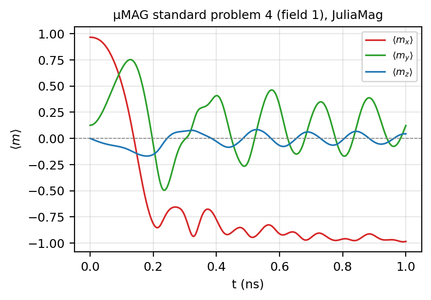
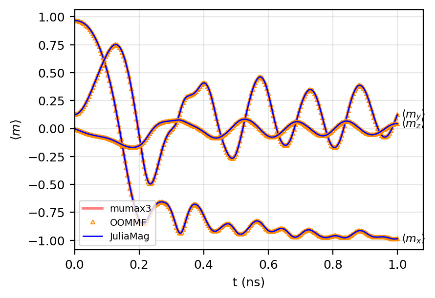

# JuliaMag

Micromagnetic simulation in pure Julia, on CPU and GPU, in double or single precision.

Inspired by [mumax3](https://github.com/mumax/3) (Vansteenkiste et al., *AIP Advances* **4**, 107133 (2014)),
but written from scratch to take advantage of Julia's multiple dispatch.

## Design

The reduced magnetization `m = M / Msat` is an `Array{T,4}` of shape `(3, Nx, Ny, Nz)`.
The vector component is the fastest-varying index, so `m[:, i, j, k]` is contiguous
and the array maps directly onto a `CuArray`.

Every routine dispatches on the array type. A CPU run passes an `Array`, a GPU run
passes a `CuArray`, and the correct method is selected — no separate code path, no
`if gpu` branches. The element type `T` is propagated too: build the material in
single precision (`material("Permalloy"; precision = Float32)` or `Material{Float32}(mat)`)
and the whole run — fields, torques, integrator — is `Float32`, mumax3's precision.
The demag kernel is always computed and transformed in `Float64`, and reductions
(averages, energies, the minimizer's step) accumulate in `Float64`.

On the GPU each field and torque term is one CUDA kernel (one thread per cell, the
same arithmetic as the CPU loop), as in mumax3. On a Quadro P1000 a single-precision
evaluation of the equation of motion for a 64×64×8 disc costs 1.11 ms, the same as
mumax3 ([`gpu_validation/README.md`](gpu_validation/README.md), Result 8).

Index convention is `(x, y, z)`, 1-based, everywhere.

## Status

First stage closed (2026-11-27): a traditional micromagnetic code, implemented, validated
and functional. What may come next is in the [roadmap](docs/roadmap.md).


- [x] **1.** Package skeleton, `Mesh`, `Material`, magnetization states
- [x] **2.** Exchange, uniaxial anisotropy, Zeeman fields (+ interfacial & bulk DMI)
- [x] **3.** Demagnetization kernel (Newell / brute-force integration)
- [x] **4.** Demagnetization field via FFT convolution
- [x] **5.** LLG torque + adaptive RK45 solver + energy minimizer + OrdinaryDiffEq integration
- [x] **6.** µMAG standard problem 4 ([`examples/`](examples/stdproblem4.jl))
- [x] **7.** Energies (exchange, demag, anisotropy, DMI, Zeeman) for convergence checking
- [x] Spin-transfer torque (Zhang-Li, Slonczewski)
- [x] Bulk DMI validated term-by-term against mumax3
- [x] Initial states (uniform, vortex, antivortex, vortex wall, two-domain,
      random, Néel/Bloch skyrmion) + OVF loading
- [x] Geometries / regions
- [x] OVF I/O and output tables
- [x] GPU (CuArray), Float64 and Float32
- [x] mumax3-style driver layer: mumax3's solvers by name (Euler, Heun, RK23, RK4,
      Dormand–Prince RK45 with MaxErr/FixDt/Headroom) plus Tsit5; spin currents and
      temperature in every solver; `TableAdd`/`TableAutosave`/`AutoSave`-style
      output; run log with wall-clock times and device; whole simulations on the GPU
      (`togpu(sim)`)
- [x] Finite temperature (stochastic LLG)
- [x] Energy barriers (geodesic NEB, climbing image, certified saddles) and linear eigenmodes
- [x] Fields and currents that vary in space and time; currents from anisotropic magnetoresistance
- [x] Desktop GUI ([`gui/`](gui/)): the solver on a worker thread, live curves and magnetization map

## Usage

A script reads like a mumax3 input file (see the [manual](docs/manual.md), Sec. 4):

```julia
using JuliaMag

# µMAG standard problem 4: a 500 × 125 × 3 nm Permalloy film
mesh = Mesh((160, 40, 1), (3.125e-9, 3.125e-9, 3e-9))
mat  = Material(Msat = 8.0e5, Aex = 1.3e-11, alpha = 0.02)

sim = Simulation(mesh, mat; outdir = "std4.out")   # table.txt and OVF files go here
setmag!(sim, UniformConfig(1, 1, 1))
relax!(sim)                                         # minimize(): the S-state
setexternalfield!(sim, (-24.6e-3, 4.3e-3, 0))       # field 1
tableadd!(sim, q_maxtorque()); tableautosave!(sim, 2.5e-12)
run!(sim, 1e-9)                                     # Dormand–Prince RK45, MaxErr 1e-5
```

`run!(sim, t; solver = :rk4, fixdt = 5e-14)` picks another of mumax3's solvers;
`setcurrent!(sim, J; …)` adds Zhang–Li and/or Slonczewski torques to every solver;
`togpu(sim)` runs the same script on a CUDA GPU.

## Standard problem 4

[`examples/stdproblem4.jl`](examples/stdproblem4.jl) runs the µMAG standard
problem 4: relax a 500 × 125 × 3 nm Permalloy film to its S-state (energy
minimizer), apply field 1 (−24.6, 4.3, 0 mT), and integrate the switching for
1 ns. It writes `stdproblem4.txt` (⟨m⟩ vs t) and this figure:



⟨mx⟩ crosses zero at ~0.14 ns and rings down to −1, ⟨my⟩ peaks near +0.75 —
matching the published µMAG reference curves.

```
julia --project=examples examples/stdproblem4.jl
```

Compared directly against **both** mumax3 and OOMMF reference runs
([`compare_mumax3.jl`](examples/compare_mumax3.jl)), the curves coincide to
within max |Δ| ≈ 0.004 (RMS ≲ 0.002) for all three components over the full
nanosecond — JuliaMag in blue, mumax3 in red, OOMMF as open triangles:



## Tests

```
julia --project=. -e 'using Pkg; Pkg.test()'
```

## Legacy

`legacy/` holds the earlier exploratory code this package replaces. It is kept for
reference only and is not loaded by the package.

## Author

Rafael L. Novak — rlnovak@gmail.com — UFSC/Blumenau, Brazil
